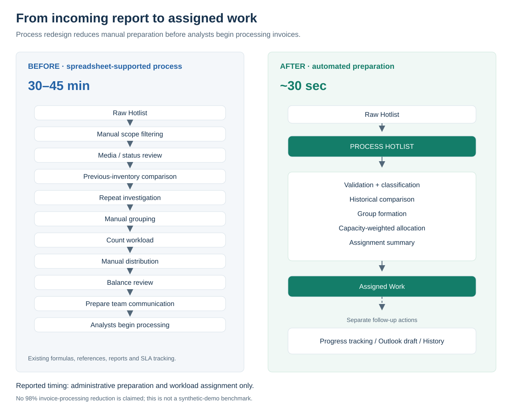
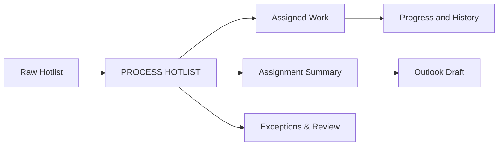
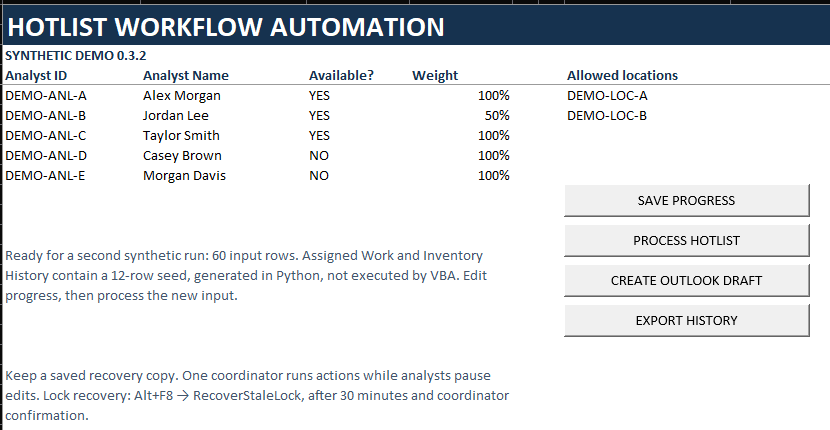
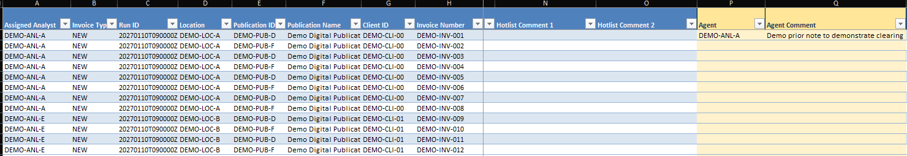
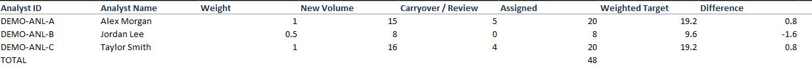
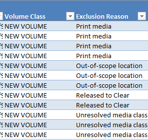
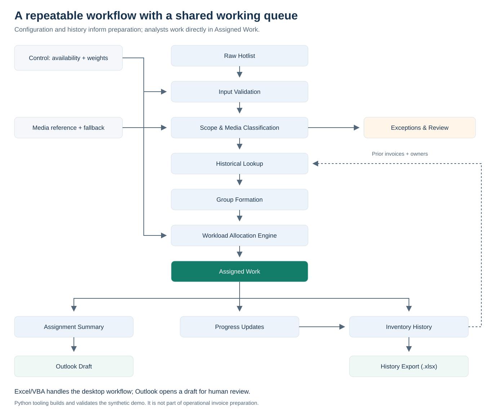

# Hotlist Workflow Automation

Turn incoming invoice inventories into validated, capacity-weighted work queues with Excel and VBA.

## 30–45 min → ~30 sec

**Reported reduction in recurring Hotlist administrative preparation and workload assignment time: approximately 98.3%–98.9%.** This applies to preparation before analysts begin work, not invoice-processing time. The result is owner-reported operational experience, not a benchmark of this synthetic demo.

The workflow is currently used to support recurring Hotlist preparation, workload assignment, and analyst follow-up, according to the project owner. This repository contains a **fully synthetic portfolio implementation**, separate from the privately held operational workbook and production data.

## Business problem → process redesign

The previous process already used formulas, references, inventory tracking, reporting, and SLA management. Coordinators still had to turn each incoming report into actionable, fairly assigned work before analysts could begin processing.

| Before | After |
| --- | --- |
| Manual scope, media, and status review | Configured validation and classification |
| Previous-inventory comparison and repeat investigation | Historical lookup and traceable classifications |
| Grouping, counting, distribution, and balance review | Group-preserving, capacity-weighted allocation |
| Prepare the working inventory and team communication | Assigned queue, summary, and Outlook draft support |
| Reported preparation: **30–45 minutes** | Reported preparation: **approximately 30 seconds** |

<details>
<summary>See the complete before-and-after process map</summary>



</details>

## What the solution does

- Validates scope and routes Print, completed, out-of-scope, and unresolved records to review.
- Compares invoice history and keeps related work with one available analyst.
- Allocates workload using relative capacity and a documented ownership-continuity exception.
- Preserves progress, Run IDs, historical snapshots, and assignment explanations.
- Supports macro-free history export and reviewable Outlook drafts; it never sends automatically.

Beyond automation, the working queue was redesigned around the analyst's task. Assignment and invoice-identification fields come first, key context remains visible during horizontal navigation, and progress is recorded directly in the same inventory. This supports clearer ownership, easier follow-up, consistent working practices, and less administrative friction; no measured UX statistic is claimed.

## Visual workflow



Processing is one action after input/configuration. Progress saving, draft creation, export, and invoice processing are separate activities.

## The synthetic demo in Excel

Approved genuine Excel Desktop captures of demo 0.3.2. See the [capture methodology and privacy review](assets/screenshots/README.md).

### Configure capacity



Analyst availability and capacity weights can be adjusted before each distribution.

### Generate analyst-ready work



The working queue is organized around analyst needs: ownership and invoice context stay visible while progress fields remain directly editable.

### Balance workload



Group-preserving weighted allocation balances workload according to analyst availability and relative capacity.

### Isolate exceptions



Non-actionable and unresolved records are routed outside the assigned queue with explicit reasons.

## Technical architecture and stack

<details>
<summary>View the workflow architecture</summary>



</details>

| Technology | Role |
| --- | --- |
| Microsoft Excel + VBA | Desktop interface, classification, assignment, progress, history, and export |
| Microsoft Outlook automation | Draft preparation for human review |
| Teams / SharePoint | Shared-master operating model; multi-user behavior needs environment-specific validation |
| Python | Builds and validates the **public synthetic demo**; not a dependency of operational invoice preparation |
| Git / GitHub | Reviewed source, reproducible artifacts, documentation, and change history |

Read the [architecture](docs/architecture.md), [assignment logic](docs/assignment-logic.md), or [history design](docs/historical-management.md) for engineering detail.

## Validation — demo 0.3.2

| Evidence | Result and scope |
| --- | --- |
| **Windows Excel Desktop runtime: PASS** | Exact artifact hash verified; repair-free opening, references, VBA compilation, analyst-first navigation/I2 freeze, Save Progress, processing, historical persistence, export, Outlook draft, normal lock release, and input clearing tested. |
| **Runtime outputs: PASS** | 48 assigned / 12 exceptions; Alex Morgan 20, Jordan Lee 8, Taylor Smith 20; 60 history records after processing. Export preserved progress/formatting/filters and A2/header-only freeze. |
| **Automated/static: PASS** | 78 structural/model/binary checks, all four embedded/source module comparisons, and privacy rescan. The original 10 binary/build regression tests pass, plus a new hash-bound desktop-evidence regression (**11 total**). |
| **Not fully runtime-tested** | Rollback/fault injection; unmatched/ambiguous progress; clearing/cancellation; negative inputs; stale locks; alternate profiles; targeted identity/allocation cases; Teams/SharePoint multi-user coauthoring. |

The [manifest](demo/embedded-vba-manifest.json) records compile **PASS** supported by [hash-bound desktop evidence](validation/desktop-acceptance.json). Static tools do not compile VBA or infer PASS from source equality. New or changed binaries require their own desktop acceptance. See [runtime results](validation/phase-3-results.md) and [scenario coverage](validation/test-scenarios.md).

## Explore the project

| Business and usability | Demo and engineering |
| --- | --- |
| [Business context](docs/business-context.md) | [Download the demo](demo/Hotlist_Workflow_Automation_Demo.xlsm) |
| [Before vs. After](docs/before-and-after.md) | [VBA source](src/vba) |
| [User guide](docs/user-guide.md) | [Architecture](docs/architecture.md) |
| [Reported impact and measurement](docs/impact-and-measurement.md) | [Assignment logic](docs/assignment-logic.md) |
| [Data privacy](docs/data-privacy.md) | [Validation results](validation/phase-3-results.md) |

```text
demo/          Clean synthetic workbook, sample inputs, expected outputs, manifest
docs/          Business case, workflow, design, limitations, and user guidance
src/vba/       Source matching the accepted workbook
assets/        Source-controlled diagrams and approved Excel screenshots
validation/    Runtime evidence, scenario coverage, and automated checks
tools/         Reproducible synthetic build and binary/source verification
```

## Privacy and engineering boundaries

Original operational files are not distributed. Names, organizations, identifiers, amounts, comments, dates, and transactional relationships in the demo are synthetic; demo emails use **example.com** only. No corporate connection is required to review the demo. Future captures must exclude real sender/account details and corporate labels.

VBA requires desktop Excel; Excel Web does not run macros. Draft creation requires compatible desktop Outlook. Whole-group allocation cannot guarantee exact equality and measures rows rather than actual processing complexity. Reference mappings need maintenance. Shared Microsoft 365 behavior remains environment-dependent; the workbook lock is advisory. See [limitations](docs/limitations.md) and the [public-release readiness review](docs/release-readiness.md).

## Try the demo

1. Download `demo/Hotlist_Workflow_Automation_Demo.xlsm` using GitHub's **Download raw file** action. Compare its SHA-256 with the [manifest](demo/embedded-vba-manifest.json) before opening.
2. On Windows, if the downloaded file is blocked, use **Properties → Unblock → Apply** if available and permitted by your normal macro policy.
3. Save a working copy, open it in **Windows desktop Excel**, and enable macros for this reviewed file.
4. Review Control availability/weights and the included synthetic data. Use **SAVE PROGRESS**, then **PROCESS HOTLIST**; inspect Assigned Work, Assignment Summary, and Exceptions & Review.
5. Optionally export history or create an Outlook draft. **No email is sent automatically.** Outlook is optional for reviewing the preparation/assignment workflow; corporate systems are not required.

Use a fresh copy to reset. Do not replace the accepted repository workbook with a saved runtime working copy. See the [user guide](docs/user-guide.md) and [rebuild guide](tools/README.md).
