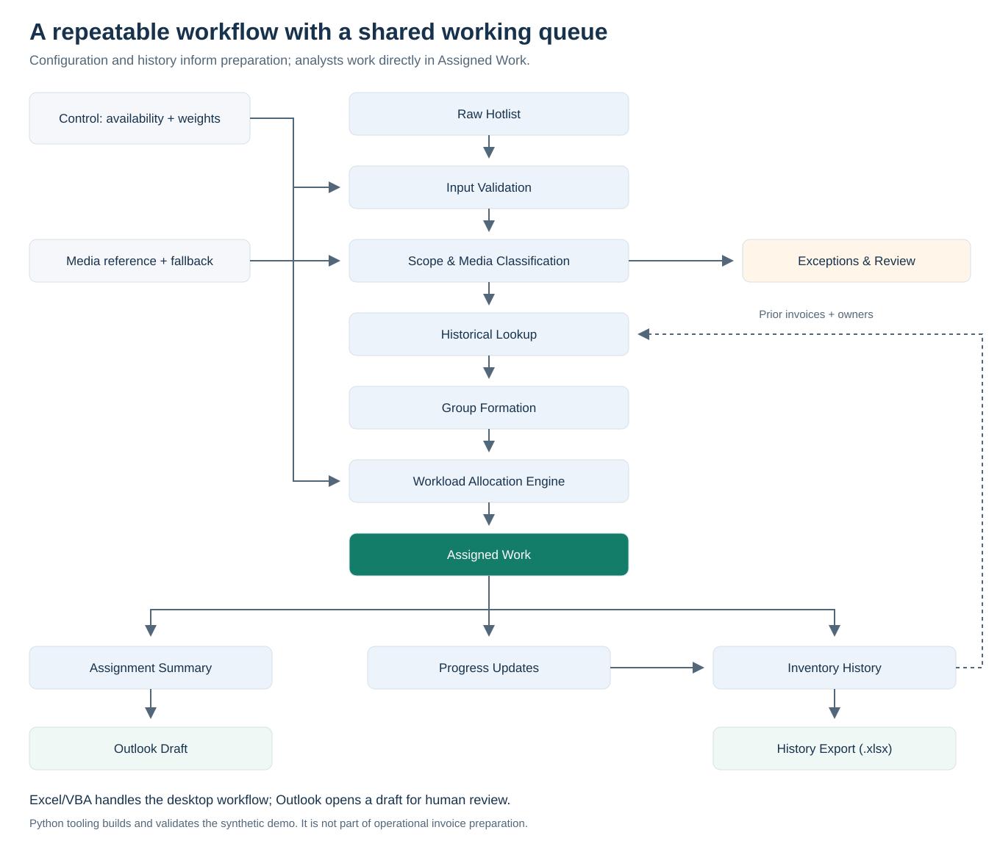
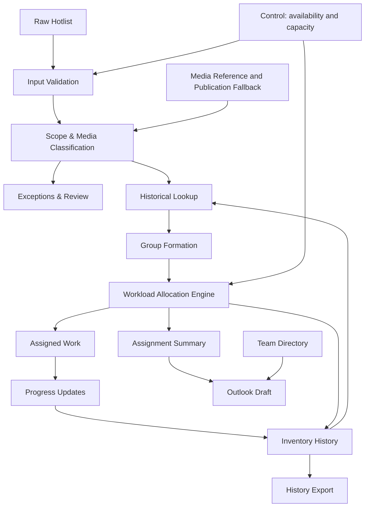

# Architecture

This diagram describes the clean demo. Four English actions are bound to the reviewed source. Desktop compilation and runtime validation must pass before screenshots are captured.

## Responsibilities

- Validation checks required fields, identity, typed dates, configuration, and run state.
- Classification separates actionable Digital rows from exceptions with reasons.
- Historical lookup identifies repeats and prior ownership using the composite identity.
- Allocation preserves groups and considers availability, capacity, and the continuity exception.
- Output publication stages results before writing. Recovery protects prior outputs and input on failure.
- Progress reconciliation updates run-specific history; it is distinct from file AutoSave.
- Outlook receives a draft summary, not an automatic send instruction.
- Export creates a separate macro-free snapshot, not a sanitized production extract.

The initial implementation target is desktop Excel on Windows with compatible desktop Outlook for email. Teams/SharePoint is an optional hosting environment, not a VBA execution service. See [limitations](limitations.md).

## Analyst-facing display projection

Raw input and history use the canonical internal schema. Assigned Work presents a different analyst-first order. DemoUtilities.WorksheetColumn maps reads, writes, and verification so ownership, identity, dates, and progress keep their meaning after reordering. Header validation checks the displayed schema before processing or saving progress.

The analyst view freezes row 1 and A:H at I2, highlights progress in P:Q, and hides technical X:AG columns. Resizing the output table after publication keeps filters and table formatting aligned with the full assigned queue. Recovery restores the physical snapshot without reprojecting it.
