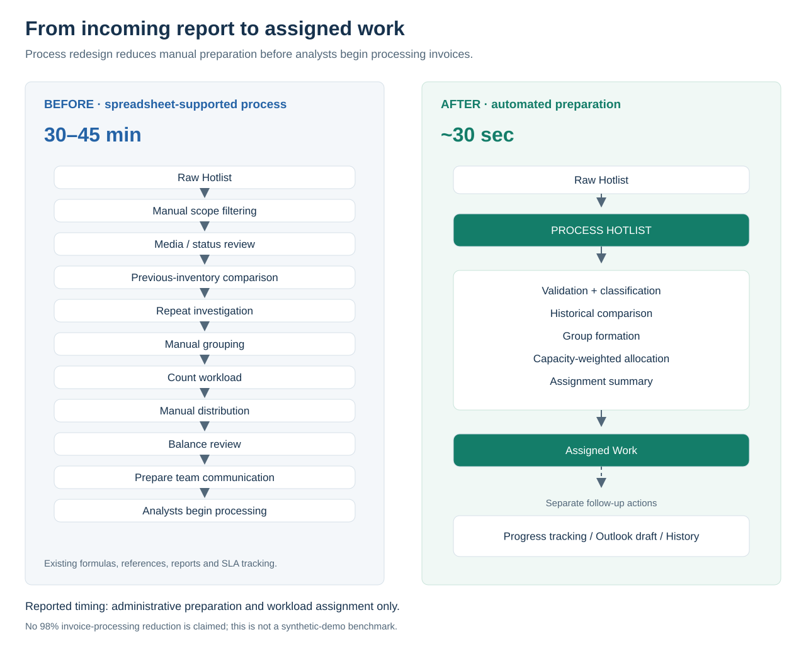

# Before and after



The previous process was spreadsheet-supported. It already used Excel formulas, reference data, SLA reporting, inventory tracking, and operational reports. The improvement focuses on transforming incoming inventory into a validated, assigned, actionable queue.

## Previous preparation

```text
Incoming Hotlist
      ↓
Manual scope filtering
      ↓
Media and status review
      ↓
Previous-inventory comparison
      ↓
Repeated-invoice investigation and previous ownership review
      ↓
Manual grouping and workload counting
      ↓
Analyst availability review
      ↓
Manual workload allocation and balance review
      ↓
Prepare final working inventory and team notification
      ↓
Analysts begin invoice processing
```

## Automated preparation

```text
Incoming Hotlist + availability and capacity settings
      ↓
Automated workflow
      ↓
Validation + classification + historical comparison
+ grouping + workload allocation + assignment summary
      ↓
Assigned Work
      ↓
Outlook notification support
      ↓
Analysts begin invoice processing
```

| Activity | Previous coordination | Automated support |
| --- | --- | --- |
| Scope | Select relevant locations | Configured scope check |
| Media | Review reference data and classify | Exact lookup, fallback, or review |
| Status | Identify non-actionable work | Explicit completed-status exclusion |
| History | Compare inventories | Historical identity lookup |
| Repeats | Investigate prior work and ownership | Repeat flags and documented continuity rule |
| Grouping | Collect related invoices | Keep each Group Key together |
| Capacity | Check people and manually calculate shares | Availability flags and relative weights |
| Distribution | Count and assign work | Largest-group-first weighted heuristic |
| Balance | Review counts manually | Targets and deviations in Assignment Summary |
| Output | Prepare working inventory | Rebuilt Assigned Work and Exceptions & Review |
| Communication | Compose notification | Separate Outlook draft action |
| Progress | Preserve updates across inventories | Explicit history reconciliation |

Reported preparation and assignment changed from approximately 30–45 minutes to approximately 30 seconds. Configuration, source acquisition, separate draft/export actions, and actual invoice processing are distinct activities. See [measurement](impact-and-measurement.md).

## Which workflow the comparison describes

This comparison describes the reported operational improvement. The current private operational workbook is the primary usability reference. The public GitHub workbook is a separate, clean synthetic implementation; it is not the production workbook and its Python expectations do not establish production runtime or adoption metrics.

The improvement includes redesigning the working queue around ownership, invoice context, visible source comments, and directly editable analyst progress. In the public demo, I2 freezes the header and assignment/identity block, P:Q highlights progress, and technical fields follow the everyday work fields.
